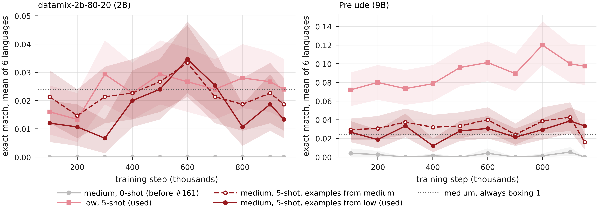

The four `polymath-eu-*` groups run 5-shot since [#161](https://github.com/OpenEuroLLM/oellm-eval/pull/161). Before that they ran 0-shot, and `multilingual-oellm-eu` ran all four tiers. It now runs none of them.

| Choice | Value | Why |
|---|---|---|
| Shots | 5 | The scorer reads only the answer in `\boxed{}`. At 0 shots the 2B boxes 3% of its medium answers and the 9B 12%, and both score 0.000 to 0.002. At 5 shots over 92% are boxed. |
| Few-shot target | `\boxed{answer}` | PolyMath has no worked solutions, so an example shows only the answer. Models then answer without working. |
| `fewshot_split` | `low` for medium, its own tier otherwise | PolyMath has no train split. lm-eval leaves the scored question out of its own examples. |
| In `multilingual-oellm-eu` | none | Low is the first 125 MGSM test questions, which `mgsm-eu` and `global-mgsm-eu` already run in en, de, es and fr. Medium scores no better than always answering 1. |

<Frame caption="Exact match averaged over de, en, es, fr, it and pt at each checkpoint, with 95% bootstrap intervals. The dotted line marks 0.024: 3 of medium's 125 questions have the answer 1 in every language.">
  
</Frame>

| Setup | 2B mean | 2B change | 9B mean | 9B change |
|---|---|---|---|---|
| medium, 0-shot (before #161) | 0.000 | 0.000 | 0.002 | 0.003 |
| medium, 5-shot, examples from low (used) | 0.018 | 0.008 | 0.027 | 0.011 |
| medium, 5-shot, examples from medium | 0.022 | 0.005 | 0.032 | 0.009 |
| low, 5-shot (used) | 0.024 | 0.005 | 0.091 | 0.012 |
| medium, always answering 1 | 0.024 | – | 0.024 | – |

"Mean" is over ten checkpoints of [`openeurollm/datamix-2b-80-20`](https://huggingface.co/openeurollm/datamix-2b-80-20) (2B, steps 100k to 950k) and [`openeurollm/prelude`](https://huggingface.co/openeurollm/prelude) (9B, steps 100,800 to 953,312, before cooldown). "Change" is the mean absolute change between consecutive checkpoints. Examples are drawn per question with lm-eval's default seed (1234). Runs used the #161 task files with lm-eval 0.4.13 in the LUMI container and all 125 questions per tier and language.

Medium sits at the floor on both models. About a quarter of the boxed medium answers are 1, and 52 of the 2B's 132 correct medium answers are questions whose answer is 1. Between checkpoints medium moves by about 0.01, some 40% of its level, so it cannot rank checkpoints.

Low at 5 shots is the only setup that rises with training, and only on the 9B: from 0.075 over the first three checkpoints to 0.106 over the last three.

Examples from low push medium toward integer answers. Every low answer is an integer, while 55 of medium's 125 are. On medium questions whose answer is not an integer, the share of boxed integers rises from 44% to 51% on the 2B and from 47% to 56% on the 9B. On the same questions, examples from low score 0.005 below examples from medium on both models.

## Caveats

- Two base models. Larger or instruction-tuned models may score above the floor on medium, high and top, so the four groups stay available outside the suite.
- High and top ran only at the last checkpoints, in #161's first runs. They score at the floor too, and the models box 1 on about a third of high's questions.
- Six languages: PolyMath's `polymath-eu-*` groups cover de, en, es, fr, it and pt only.

<Accordion title="Reproduce">
  Each setup is a task YAML next to a copy of the bundled PolyMath task folder (`_default_template_yaml`, `utils.py` and `polymath_eval.py`). Medium with examples from medium:

  ```yaml
  include: _default_template_yaml
  task: pmaudit_de_medium_own
  dataset_name: de
  test_split: medium
  fewshot_split: medium
  ```

  List one row per checkpoint, task and shot count. `model_path` is a local snapshot of a checkpoint branch, for example from `snapshot_download("openeurollm/prelude", revision="iter_0953312")`. The bundled tasks give the other setups: `polymath_de_medium` at 0 or 5 shots and `polymath_de_low` at 5.

  ```csv
  model_path,task_path,n_shot,eval_suite
  /path/to/prelude/iter_0953312,pmaudit_de_medium_own,5,lm-eval-harness
  /path/to/prelude/iter_0953312,polymath_de_medium,5,lm-eval-harness
  ```

  ```bash
  oellm-eval schedule --eval_csv_path evals.csv --lm_eval_include_path tasks/
  oellm-eval collect --results_dir <run directory> --output_csv results.csv --check true
  ```
</Accordion>
