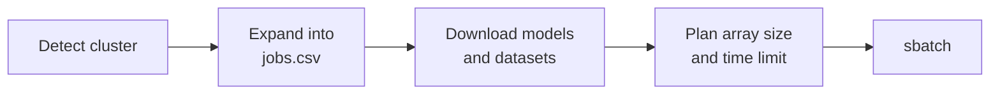

`oellm-eval schedule` turns your models × benchmarks into a SLURM array job.



1. **Detect the cluster** from SLURM's cluster name or the hostname, and load its preset.
2. **Expand** the task groups into one row per evaluation in `jobs.csv`.
3. **Download** models and datasets on the login node. Jobs run offline.
4. **Plan** the array: how many jobs, how many evaluations each, and the time limit.
5. **Submit.** Each array job runs its slice of `jobs.csv`. lm-eval tasks for the same model are batched so the model loads once.

Each run gets its own folder:

```text
$EVAL_OUTPUT_DIR/2026-09-25-10-15-02/
├── jobs.csv              # every evaluation
├── submit_evals.sbatch   # the submitted script
├── slurm_logs/           # one .out/.err per array job
└── results/              # result JSON files
```

## Cluster presets

| Cluster | Partition | Account | Queue limit |
|---|---|---|---|
| LUMI | `small-g` | `project_465002530` | 210 |
| Leonardo | `boost_usr_prod` | `OELLM_prod2026` | 1000 |
| JURECA | `dc-gpu` | `synthlaion` | 250 |
| Jupiter | `booster` | `reformo` | 250 |
| Snellius | `gpu_h100` | `thomaso` | 30 |
| UFAL | `gpu-ms,gpu-troja` | none | 10 |

Every job gets 1 GPU and 96G of memory by default. Full presets: [Configuration](/reference/configuration).

## Changing SLURM settings

```bash
oellm-eval schedule --models "$MODEL" --task_groups "dclm-core-22" \
    --slurm_template_var '{"PARTITION":"dev-g","TIME":"02:00:00","SLURM_MEM":"128G"}'
```

| Key | Sets |
|---|---|
| `TIME` | Time limit **per array job** (`HH:MM:SS`) |
| `PARTITION`, `ACCOUNT` | Partition and account |
| `SLURM_MEM` | Host memory |
| `GPUS_PER_NODE` | GPUs per job (only evalchemy uses more than one) |
| `NODES` | Node count |

Also: `--max_array_len` (max concurrent jobs, default 128), `--tasks_per_job` (lm-eval tasks per model load, default 8), `--nodelist`.

### Time limits

By default the limit is estimated at **10 minutes per evaluation** × evaluations per job × 1.2, rounded up to whole hours and kept between 3 and 23 hours. That suits small models; for 7B+ models set `TIME` yourself (`"11:59:00"` is a safe start), since a timeout loses the rest of that job's evaluations.

### Queue limits

oellm-eval keeps your queued and running jobs under the cluster's queue limit. With no free slots it submits nothing (`No remaining queue capacity`); with a few, it makes fewer, longer jobs.

## LUMI

Always pass the ROCm venv; the container's lighteval can't use LUMI's AMD GPUs:

```bash
export HF_HOME=/scratch/project_465002530/cache

oellm-eval schedule --models "$MODEL" --task_groups "multilingual-oellm-eu" \
    --venv_path /scratch/project_465002530/venvs/oellm-eval-rocm
```

- Runs go to `/scratch/project_465002530/oellm-cli-shared-evals/$USER/`, visible to the whole project. Set `EVAL_OUTPUT_DIR` to keep them elsewhere.
- Each evaluation gets one MI250X GCD (64 GB), enough for a 9B model.
- Use `dev-g` for quick tests only:

  ```bash
  oellm-eval schedule --models "$MODEL" --task_groups "multilingual-oellm-eu[deu_Latn]" \
      --venv_path /scratch/project_465002530/venvs/oellm-eval-rocm \
      --max_array_len 2 --limit 8 --slurm_template_var '{"PARTITION":"dev-g","TIME":"01:30:00"}'
  ```
- Don't export `HF_HUB_OFFLINE=1` on the login node; scheduling needs to download. Jobs are offline already.
- Jobs can take 10–15 minutes to start working (loading task registries and weights from Lustre).
- `sacct` shows `gres/gpu:a100` in `ReqTRES`: that's only an accounting label. `AllocTRES` shows the real `gres/gpu:mi250`.

To build your own ROCm venv, see [Installation](/installation#build-a-venv).

## Running without SLURM

`--local true` runs every evaluation in sequence on the current machine (a laptop or an interactive GPU node). It needs a venv:

```bash
oellm-eval schedule --models "EleutherAI/pythia-160m" --tasks "hellaswag" --n_shot 0 \
    --venv_path .venv --local true --limit 8
```

Results go to `./oellm-output/`. Local runs can use the internet; on an offline compute node, export `HF_HOME` and `HF_HUB_OFFLINE=1` first, after staging downloads on the login node with `--download_only true`.
